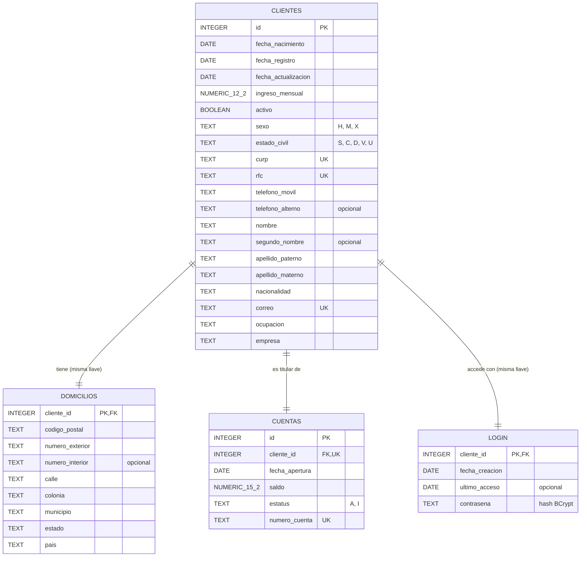

# Onboarding de Clientes Personas Físicas — Documento técnico

## 1. Qué hace
API REST (Spring Boot 3.3.6, Java 17, PostgreSQL, Flyway) que registra clientes personas físicas,
valida su información, les abre automáticamente una cuenta bancaria ACTIVA con el saldo inicial del
sistema y les crea su acceso (login). Permite consultarlos, actualizarlos, darlos de baja lógica e
iniciar sesión con correo y contraseña.

Se respeta la arquitectura del proyecto base: `controller → service → repositorys → entity`,
migraciones Flyway en `db/migration` y la configuración manual de `ConfigDB`.

## 2. Diagrama entidad-relación



Script de creación: `../src/main/resources/db/migration/V2__onboarding_clientes.sql`.

## 3. Decisiones de base de datos

| Decisión | Por qué |
|---|---|
| Todos los textos son `TEXT` | En PostgreSQL `TEXT` y `VARCHAR(n)` ocupan lo mismo y rinden igual. La longitud y el formato se garantizan con `CHECK` (`char_length`, expresiones regulares). |
| Fechas `DATE` | Fecha simple año-mes-día, 4 bytes, sin hora. |
| Dinero `NUMERIC(p,2)` | Siempre 2 decimales exactos. `FLOAT/DOUBLE` redondean centavos. |
| Catálogos de un carácter | Sexo (`H`,`M`,`X`), estado civil (`S`,`C`,`D`,`V`,`U`) y estatus (`A`,`I`). En Java son `enum`; el `CHECK` solo admite esos códigos. |
| Columnas de ancho fijo primero, textos al final | PostgreSQL alinea columnas; este orden reduce bytes de relleno por fila. |
| `domicilios` y `login` usan `cliente_id` como PK y FK | Relación 1 a 1: cada tabla se ahorra una columna y un índice. |
| `login` en tabla aparte | Las credenciales quedan separadas de los datos personales. El correo no se duplica: vive en `clientes`. |
| Secuencia `seq_numero_cuenta` | Número de cuenta de 10 dígitos, único aunque haya altas simultáneas. |
| Índices parciales (`WHERE activo`, `WHERE estatus = 'A'`) | Solo indexan las filas que se consultan. |
| Sin `ON DELETE CASCADE` | Nunca se borra un cliente (baja lógica); la FK impide borrarlo por error. |

## 4. Cómo está programada la lógica

- **Validación de entrada.** Los DTO usan Bean Validation (`@NotBlank`, `@Size`, `@Email`, `@Pattern`,
  `@Positive`, entre otras) y los controladores reciben DTO con `@Valid`. `ClienteValidador` conserva las
  reglas de negocio que requieren validar coherencia entre campos, como mayoría de edad y coincidencia
  de CURP/RFC con los datos personales. El manejador global devuelve los errores como **400 Bad Request**
  con todos los mensajes agrupados por campo en `datos`, además del mensaje general y la lista plana en
  `detalles`. Si un campo incumple varias reglas Bean Validation, se informan todas.
- **Requests por operación.** `ClienteRequest` se usa para alta, actualización y baja; las búsquedas
  tienen DTOs independientes `ConsultaClienteRequest` y `ConsultaCuentaRequest`, cuyos campos son
  filtros opcionales. `CuentaRequest`, `NacionalidadRequest`, `LoginRequest`, `PersonasRequest` y el
  `DomicilioRequest` anidado se usan en sus operaciones correspondientes.
- **Campos desconocidos se rechazan.** Los requests del onboarding heredan de `SolicitudEstricta`: si el JSON trae un
  campo que no existe, responde 400. Los campos conocidos pero prohibidos en una operación, como CURP o RFC
  durante una actualización, también se rechazan.
- **Enums con código de un carácter.** `Sexo`, `EstadoCivil` y `EstatusCuenta` implementan `Catalogo`.
  La API acepta el nombre (`MUJER`) o el código (`M`); un `AttributeConverter` guarda solo el código.
- **Entidades con relaciones y comportamiento.** `Cliente` es la raíz: tiene `@OneToOne` con cascada hacia
  `Domicilio`, `Cuenta` y `Login`, así que un solo `save()` guarda las cuatro tablas.
  Las reglas viven en la entidad: `abrirCuenta()`, `crearAcceso()` y `darDeBaja()` (que inactiva la cuenta).
- **Persistencia sin `@Transactional` en servicios.** Los servicios llaman explícitamente a `save` o
  `saveAndFlush` cuando cambian una entidad; las operaciones del repositorio gestionan su persistencia.
- **Consultas JPQL con `@Query`** y `JOIN FETCH`: todo sale en un solo `SELECT`. El saldo se consulta con
  una proyección que trae solo esa columna.
- **Login.** La contraseña se guarda como hash BCrypt (nunca en claro ni en las respuestas). Errores
  distintos para correo no encontrado y contraseña errónea. Al iniciar sesión se entrega un token
  Bearer firmado y con expiración.
- **Autorización.** Las rutas de clientes y cuentas requieren `Authorization: Bearer <token>`, salvo
  `POST /clientes` (alta). El token identifica al cliente; las consultas y modificaciones por ID
  comprueban que el recurso pertenezca a ese cliente. Los listados solo devuelven los recursos propios.
  El login, el alta y el catálogo de nacionalidades son públicos.
- **Excepciones.** Las excepciones de negocio heredan de `NegocioException`, que lleva su código HTTP,
  clave y detalles. `GlobalExceptionHandler` también procesa errores de Bean Validation y JSON ilegible
  y responde en un mismo formato JSON.
- **Respuesta de endpoints.** Todas las operaciones responden con `GenericResponse`: `codigo`, `mensaje`
  y `datos`. El resultado propio de cada consulta (cliente, lista, cuenta, saldo, nacionalidad o login)
  se devuelve dentro de `datos`; los errores de validación exponen sus mensajes en `mensaje` y `detalles`.
  El código funcional es `0` para éxito y `1` para error; el estado HTTP se mantiene por separado.

## 5. Validaciones por campo

| Campo | Reglas |
|---|---|
| nombre, apellidoPaterno, apellidoMaterno | Obligatorios, solo letras y espacios, 2 a 50 caracteres |
| segundoNombre | Opcional; si viene, mismas reglas |
| fechaNacimiento | Obligatoria, formato `AAAA-MM-DD`, fecha real, no futura, 18 años cumplidos |
| curp | Obligatoria, 18 caracteres, formato oficial; su fecha y sexo deben coincidir con los capturados |
| rfc | Obligatorio, 12 o 13 caracteres, formato oficial; su fecha debe coincidir con la de nacimiento |
| sexo | Obligatorio: `HOMBRE`/`H`, `MUJER`/`M`, `NO_BINARIO`/`X` |
| estadoCivil | Obligatorio: `SOLTERO`/`S`, `CASADO`/`C`, `DIVORCIADO`/`D`, `VIUDO`/`V`, `UNION_LIBRE`/`U` |
| nacionalidad | Obligatoria, solo letras, 2 a 40 |
| correo | Obligatorio, formato válido, máximo 100; único |
| telefonoMovil | Obligatorio, exactamente 10 dígitos |
| telefonoAlterno | Opcional, exactamente 10 dígitos, distinto del móvil |
| domicilio.calle / colonia / municipio | Obligatorios, 2 a 100 / 80 / 80, sin caracteres extraños |
| domicilio.numeroExterior | Obligatorio, 1 a 10 |
| domicilio.numeroInterior | Opcional, 1 a 10 |
| domicilio.estado / pais | Obligatorios, solo letras, 2 a 50 |
| domicilio.codigoPostal | Obligatorio, exactamente 5 dígitos |
| ocupacion | Obligatoria, solo letras, 2 a 60 |
| empresa | Obligatoria, 2 a 80 |
| ingresoMensual | Obligatorio, mayor a cero, máximo 2 decimales y 10 enteros |
| contrasena (alta) | Obligatoria, 8 a 72, sin espacios, con mayúscula, minúscula y dígito |
| id (cuerpo) | Entero positivo |
| numeroCuenta (cuerpo) | Exactamente 10 dígitos |
| fechaRegistroDesde / fechaRegistroHasta (cuerpo) | Fechas `AAAA-MM-DD`; desde no posterior a hasta |

## 6. Reglas de negocio y dónde se cumplen

| Regla | Dónde |
|---|---|
| Mayor de edad | `Validaciones.fechaNacimiento` |
| CURP / RFC / correo únicos | `ClienteServiceImpl.verificarQueNoExista` + `UNIQUE` en la base |
| Teléfono de 10 dígitos | `Validaciones.telefono` + `CHECK` |
| Saldo inicial no negativo | `OnboardingProperties`, `Cuenta.abrir`, `CHECK` |
| Número de cuenta único | Secuencia + `UNIQUE` |
| Solo clientes activos con cuentas activas | `Cliente.abrirCuenta` y `Cliente.darDeBaja` |
| CURP, RFC y número de cuenta no modificables | El request común los rechaza durante la actualización + `updatable = false` |
| Baja lógica | `DELETE /clientes` recibe el `id` en el body y solo cambia `activo` y `estatus` |

## 7. Endpoints

| Método | Ruta | Descripción | Éxito |
|---|---|---|---|
| POST | `/clientes` | Registra cliente, abre su cuenta y crea su login | 201 |
| POST | `/clientes/consulta` | Busca combinando los filtros del body | 200 |
| PUT | `/clientes` | Actualiza datos modificables; el body incluye `id` y `datos` | 200 |
| DELETE | `/clientes` | Baja lógica; el body incluye `id` | 200 |
| POST | `/cuentas/consulta` | Busca cuentas combinando los filtros del body | 200 |
| GET | `/cuentas/activas` | Cuentas activas | 200 |
| POST | `/cuentas/saldo` | Saldo por número recibido en el body | 200 |
| POST | `/nacionalidades/consulta` | Verifica una nacionalidad mediante el body | 200 |
| POST | `/login` | Inicio de sesión con correo y contraseña | 200 |

En todas las rutas protegidas se debe enviar `Authorization: Bearer <token>` con el token recibido
en el login. La búsqueda de clientes limita resultados al titular autenticado; la actualización y la baja
verifican que el `id` del body corresponda a ese titular. La ausencia de token,
un token inválido o expirado responden `401 NO_AUTENTICADO`. Los endpoints de listados de clientes
y cuentas requieren token; las cuentas listadas corresponden únicamente al titular autenticado.

Los criterios de `/clientes/consulta` son opcionales y se combinan entre sí; admite `id`, `curp`,
`rfc`, `correo`, `numeroCuenta`, `activo`, `fechaRegistroDesde` y `fechaRegistroHasta`. El body `{}`
consulta el cliente autenticado. Ejemplo:

```json
{
  "activo": true,
  "correo": "zayda@correo.com",
  "fechaRegistroDesde": "2025-01-01",
  "fechaRegistroHasta": "2025-12-31"
}
```

Los criterios de `/cuentas/consulta` también son opcionales y combinables: `numeroCuenta`, `estatus`,
`fechaAperturaDesde` y `fechaAperturaHasta`. La búsqueda siempre se limita a las cuentas del titular
autenticado. Ejemplo:

```json
{
  "estatus": "ACTIVA",
  "fechaAperturaDesde": "2025-01-01",
  "fechaAperturaHasta": "2025-12-31"
}
```

### Errores

| HTTP | Clave | Cuándo |
|---|---|---|
| 400 | `ERROR_VALIDACION` | Cualquier dato inválido, campo desconocido o JSON mal formado |
| 401 | `CONTRASENA_INCORRECTA` | Login: contraseña errónea |
| 401 | `NO_AUTENTICADO` | Falta un token Bearer válido o expiró |
| 403 | `ACCESO_DENEGADO` | El token es válido, pero el recurso pertenece a otro cliente |
| 404 | `CORREO_NO_ENCONTRADO` | Login: correo no encontrado |
| 404 | `CLIENTE_NO_ENCONTRADO` / `CUENTA_NO_ENCONTRADA` | Consulta sin resultado |
| 409 | `CURP_DUPLICADA` / `RFC_DUPLICADO` / `CLIENTE_YA_REGISTRADO` | Duplicados |
| 409 | `CLIENTE_INACTIVO` | Cliente dado de baja |
| 500 | `ERROR_INTERNO` | Error inesperado; se registra internamente y no se exponen detalles técnicos |

```json
{
  "codigo": 1,
  "mensaje": "La información enviada no cumple las reglas de validación",
  "datos": {
    "nombre": ["es obligatorio", "debe tener entre 3 y 50 caracteres", "solo admite letras y espacios"],
    "telefonoMovil": ["debe contener exactamente 10 dígitos"],
    "ingresoMensual": ["debe ser mayor que cero"]
  },
  "error": "ERROR_VALIDACION",
  "detalles": [
    "nombre: es obligatorio",
    "nombre: debe tener entre 3 y 50 caracteres",
    "nombre: solo admite letras y espacios",
    "telefonoMovil: debe contener exactamente 10 dígitos",
    "ingresoMensual: debe ser mayor que cero"
  ]
}
```

Los errores de validación incluyen una entrada en `datos` por cada campo y todos sus mensajes, además
de una lista plana `detalles` para consumidores existentes. Se incluye el requisito concreto (formato,
longitud, rango u opciones admitidas). Por ejemplo, un correo inválido indica el patrón
esperado; un tipo incompatible en JSON señala la ruta del campo y el tipo requerido. Si el cuerpo
es `null`, la respuesta indica que debe enviarse un objeto JSON. Las respuestas no repiten
contraseñas ni otros valores enviados.

### Ejemplo de alta (POST /clientes)

```json
{
  "nombre": "Zayda",
  "segundoNombre": "Fernanda",
  "apellidoPaterno": "Vargas",
  "apellidoMaterno": "Vargas",
  "fechaNacimiento": "1995-03-12",
  "curp": "VAVZ950312MGTRRY07",
  "rfc": "VAVZ950312AB1",
  "sexo": "M",
  "nacionalidad": "Mexicana",
  "estadoCivil": "S",
  "correo": "zayda@correo.com",
  "telefonoMovil": "4181234567",
  "domicilio": {
    "calle": "Hidalgo",
    "numeroExterior": "12",
    "colonia": "Centro",
    "municipio": "Dolores Hidalgo",
    "estado": "Guanajuato",
    "codigoPostal": "37800",
    "pais": "México"
  },
  "ocupacion": "Ingeniera",
  "empresa": "UTNG",
  "ingresoMensual": 15000.00,
  "contrasena": "Segura123"
}
```

Para actualizar, se envía un solo objeto con el identificador y los datos modificables; los campos controlados
por el servidor (CURP, RFC, contraseña, número de cuenta, fechas de registro y estado) no se aceptan.
La respuesta de consulta incluye el `id` asignado por el servidor para poder dirigir una actualización o baja.

```json
{
  "id": 1,
  "nombre": "Zayda",
  "apellidoPaterno": "Vargas",
  "apellidoMaterno": "Vargas",
  "fechaNacimiento": "1995-03-12",
  "sexo": "M",
  "nacionalidad": "Mexicana",
  "estadoCivil": "S",
  "correo": "zayda@correo.com",
  "telefonoMovil": "4181234567",
  "domicilio": {
    "calle": "Hidalgo",
    "numeroExterior": "12",
    "colonia": "Centro",
    "municipio": "Dolores Hidalgo",
    "estado": "Guanajuato",
    "codigoPostal": "37800",
    "pais": "México"
  },
  "ocupacion": "Ingeniera",
  "empresa": "UTNG",
  "ingresoMensual": 15000.00
}
```

### Ejemplo de login (POST /login)

```json
{ "correo": "zayda@correo.com", "contrasena": "Segura123" }
```

## 8. Cómo ejecutarlo

1. Crear la base vacía: `CREATE DATABASE prueba_onboarding;`
2. Revisar usuario, contraseña y nombre de la base en `src/main/resources/application.properties`.
3. Definir `SEGURIDAD_JWT_SECRETO` con un secreto de al menos 32 caracteres; no lo guardes en el
   repositorio.
4. `./gradlew bootRun` (Flyway crea las tablas al arrancar).
5. Abrir `http://localhost:8081/swagger-ui.html`.
6. Pruebas unitarias: `./gradlew test`.

## 9. Pruebas sugeridas para las evidencias

| # | Prueba | Resultado esperado |
|---|---|---|
| 1 | Alta correcta | 201, cuenta ACTIVA de 10 dígitos, saldo e ingreso con 2 decimales |
| 2 | Alta con varios campos inválidos a la vez | 400 con un mensaje por cada campo |
| 3 | Misma CURP / mismo RFC / mismo correo | 409 con su clave |
| 4 | Menor de edad, fecha futura, fecha `12/03/1995`, 30 de febrero | 400 |
| 5 | Ingreso con 3 decimales, en cero o negativo | 400 |
| 6 | Sexo `Z` o estado civil inexistente | 400 con las opciones válidas |
| 7 | Campo que no existe en el JSON | 400 |
| 8 | PUT con datos nuevos | 200, mismos CURP, RFC y número de cuenta |
| 9 | PUT enviando `curp` | 400 |
| 10 | Login correcto | 200 |
| 11 | Login con correo no registrado | 404 `CORREO_NO_ENCONTRADO` |
| 12 | Login con contraseña errónea | 401 `CONTRASENA_INCORRECTA` |
| 13 | DELETE y luego GET por id | 204; sigue existiendo con `activo: false` y cuenta INACTIVA |
| 14 | Login de un cliente dado de baja | 409 `CLIENTE_INACTIVO` |
| 15 | Consultas por CURP, RFC, correo, cuenta, saldo, activos y rango de fechas | 200 |
| 16 | Id o cuenta inexistentes | 404 |
| 17 | Consultar, actualizar o dar de baja otro cliente por ID | 403 `ACCESO_DENEGADO` |
| 18 | Consultar la cuenta de otro cliente o su saldo | 403 `ACCESO_DENEGADO` |
| 19 | Consultar rutas protegidas sin token, con token inválido o expirado | 401 `NO_AUTENTICADO` |
| 20 | Consultar listados con un token válido | Solo recursos del titular |
